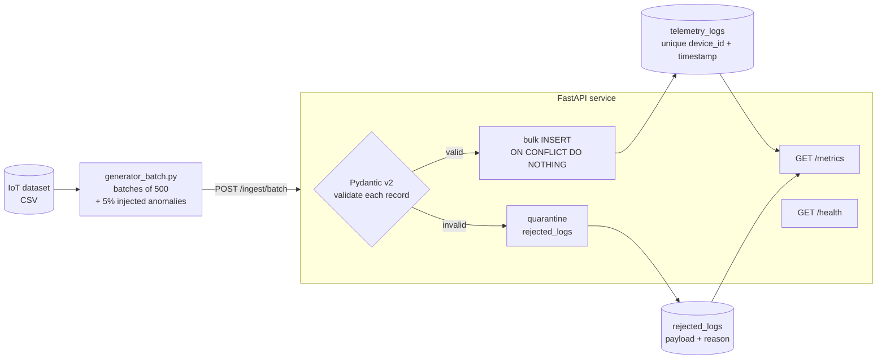

# Telemetry Ingestion & Validation Pipeline

A validation-first ingestion microservice for IoT sensor telemetry, inspired by high-throughput
logging pipelines. It accepts JSON readings over HTTP, **validates every record against a strict
schema, quarantines the bad ones (with the reason), bulk-inserts the good ones idempotently**, and
reports pipeline health through a `/metrics` endpoint.

Built and tested against a real dataset: **405,184 environmental sensor readings** from 3 devices
(CO, LPG, smoke, humidity, temperature, light, motion).

## Features

- **Strict validation (Pydantic v2):** MAC-address device IDs, numeric ranges, strict types; unknown or missing fields are rejected.
- **Per-record handling in batches:** one bad record never rejects the rest of the batch.
- **Quarantine table:** every rejected record is stored with its raw payload and the validation message, so nothing disappears silently.
- **Idempotent loads:** a unique `(device_id, timestamp)` key means re-sending data never creates duplicates.
- **Bulk inserts:** a single transaction per request, in chunks, using `INSERT ... ON CONFLICT DO NOTHING`.
- **Observability:** `/metrics` reports totals, error rate, rolling throughput and sensor averages; `/health` for liveness.
- **SQLite or PostgreSQL:** chosen by one environment variable (`DATABASE_URL`), tested on SQLite and Supabase Postgres.
- **Automated tests:** pytest suite running against a throwaway database.

## Architecture



## Tech stack

Python 3.10+, FastAPI, Uvicorn, Pydantic v2, SQLAlchemy 2.0, SQLite / PostgreSQL (Supabase), pandas, requests, pytest.

## Quick start

```bash
# 1. Install
python -m venv .venv
.venv\Scripts\activate            # macOS/Linux: source .venv/bin/activate
pip install -r requirements.txt

# 2. Configure (optional: defaults to local SQLite)
copy .env.example .env            # macOS/Linux: cp .env.example .env

# 3. Get the data: download the "Environmental Sensor Telemetry Data" CSV from Kaggle
#    and save it as data/iot_telemetry_data.csv  (the file is git-ignored: 60 MB)
https://www.kaggle.com/datasets/garystafford/environmental-sensor-data-132k

# 4. Start the API
uvicorn src.main:app --reload

# 5. In a second terminal, stream data into it
python -m src.generator_batch                 # 20,000 rows
python -m src.generator_batch --rows 0        # the full dataset
```

Interactive API docs: <http://127.0.0.1:8000/docs>

Generator options: `--rows N` (0 = all), `--batch-size N`, `--anomaly-rate 0.05`, `--seed N` (repeatable runs).

## API reference

| Method | Path | Purpose |
|---|---|---|
| POST | `/ingest/batch` | Validate and bulk-insert up to 5,000 records |
| POST | `/ingest` | Validate and insert one record (409 if it already exists) |
| GET | `/metrics` | Totals, error rate, throughput, sensor averages |
| GET | `/logs/recent?limit=10` | Most recent stored readings |
| GET | `/health` | Liveness check |

### Try it (PowerShell)

```powershell
$body = '{"timestamp":1594512094.38,"device_id":"b8:27:eb:bf:9d:51","co":0.0049,"humidity":51.0,"light":false,"lpg":0.0076,"motion":false,"smoke":0.0204,"temp":22.7}'
Invoke-RestMethod -Method Post -Uri http://127.0.0.1:8000/ingest -ContentType "application/json" -Body $body
Invoke-RestMethod http://127.0.0.1:8000/metrics | ConvertTo-Json -Depth 5
```

### Try it (curl)

```bash
curl -X POST http://127.0.0.1:8000/ingest/batch -H "Content-Type: application/json" -d '{
  "records": [
    {"timestamp":1594512094.38,"device_id":"b8:27:eb:bf:9d:51","co":0.0049,"humidity":51.0,"light":false,"lpg":0.0076,"motion":false,"smoke":0.0204,"temp":22.7},
    {"timestamp":1594512095.00,"device_id":"b8:27:eb:bf:9d:51","co":0.0049,"humidity":150.0,"light":false,"lpg":0.0076,"motion":false,"smoke":0.0204,"temp":22.7}
  ]}'
# -> {"received":2,"accepted":1,"duplicates":0,"rejected":1,"sample_errors":[{"index":1,"error":"humidity: Input should be less than or equal to 100"}]}
```

### Sample `/metrics` response (after loading the full dataset)

```json
{
  "totals": { "received": 405172, "stored": 384975, "rejected": 20197 },
  "error_rate_pct": 4.98,
  "throughput": { "window_seconds": 60, "records_in_window": 0, "records_per_sec": 0.0 },
  "unique_devices": 3,
  "averages": { "temperature_celsius": 22.46, "humidity_pct": 60.51, "carbon_monoxide": 0.0046, "smoke": 0.0193 }
}
```

`received` = stored + rejected. Duplicates skipped by the unique key are reported in the `/ingest/batch` response but are not counted as received. `records_per_sec` is an average over the last 60 seconds, so it reads 0 once traffic stops.

## Validation rules

| Field | Rule |
|---|---|
| `timestamp` | number (epoch seconds) |
| `device_id` | MAC address `aa:bb:cc:dd:ee:ff`; trimmed and lower-cased first |
| `co`, `lpg`, `smoke` | number, >= 0 |
| `humidity` | number, 0-100 |
| `temp` | number, -50 to 150 (Celsius) |
| `light`, `motion` | boolean |
| anything else | all fields required; no `null`s |

## Results on the real dataset

Full load of all 405,184 rows (5% of records deliberately corrupted by the generator):

| Outcome | Rows |
|---|---|
| Stored | 384,975 |
| Rejected and quarantined | 20,197 (4.98%) |
| Duplicates skipped | 12 |
| **Total** | **405,184** |

Quarantined records, grouped by reason:

| Reason | Count |
|---|---|
| `device_id`: field required | 6,803 |
| `temp`: not a valid number | 6,799 |
| `humidity`: above 100 | 6,595 |

**Data-quality finding:** the source CSV itself contains 13 exact duplicate `(device, timestamp)` rows (the same transmission recorded twice). The unique key makes sure each reading is stored once.

### Throughput

Each row is a different version of the code, so only compare numbers within a version.

- **v1:** single-record `POST /ingest`, one commit per row.
- **v2:** batch endpoint, valid rows bulk-inserted.
- **v3:** v2 + quarantine table + `/metrics` error rate.
- **v4 (current):** v3 + unique `(device_id, timestamp)` key and `ON CONFLICT DO NOTHING`.

| Version | Database | Rows | Time | Throughput |
|---|---|---|---|---|
| v1 | Supabase (remote) | 500 | n/a | ~1 row/s |
| v2 | Supabase (remote) | 20,000 | 47.0 s | 425 rows/s |
| v2 | SQLite (local) | 20,000 | 1.4 s | 14,089 rows/s |
| v3 | SQLite (local) | 20,000 | 1.2 s | 16,445 rows/s |
| v4 | SQLite (local) | 20,000 | 5.9-7.4 s | 2.7-3.4k rows/s |
| **v4 (current)** | **SQLite (local)** | **405,184** | **111.8 s** | **3,625 rows/s** |

Takeaways:
- Batching improved remote throughput by roughly 400x over single-row inserts; the remote-vs-local gap is network latency, not validation cost.
- Idempotency (v4) costs throughput compared with v3. That is a deliberate trade: a re-run, retry or replay can no longer double-count data.
- Throughput stayed flat from the 20k to the 405k load.
- Measured on a single developer laptop with the project in a OneDrive folder; treat the numbers as relative, not absolute.

## Design decisions

- **Plain `def` endpoints:** SQLite and psycopg2 are blocking drivers, so FastAPI runs the handlers in its threadpool instead of blocking the event loop.
- **Validate records individually:** the batch body is `list[dict]` validated record by record, so the response can report exactly which records failed and why.
- **Validation errors never reach the database layer:** bad data is stopped at the schema, and the DB constraint (unique key) is a second line of defence.
- **Errors do not leak internals:** database failures return a generic 500 and are logged server-side.
- **Same code, two databases:** the dialect-specific `ON CONFLICT` insert is chosen at runtime.

## Tests

```bash
pytest -v
```

The suite uses a temporary SQLite database (never your real data) and covers: valid and invalid single records, duplicates (409), quarantine behaviour, MAC normalisation, mixed batches, idempotent re-loads, duplicates inside one batch, envelope validation, empty and populated `/metrics`, and `/logs/recent` ordering and limits.

## Project structure

```
telemetry-pipeline/
├── src/
│   ├── main.py              # FastAPI app and endpoints
│   ├── schemas.py           # Pydantic models and validation rules
│   ├── database.py          # SQLAlchemy engine, models, dialect helper
│   └── generator_batch.py   # CSV -> anomaly injection -> batched POSTs
├── tests/
│   ├── conftest.py          # throwaway test database + client fixture
│   └── test_api.py
├── data/                    # put iot_telemetry_data.csv here (git-ignored)
├── .env.example
├── pytest.ini
├── requirements.txt
└── README.md
```

## Limitations and next steps

- No authentication or rate limiting on the endpoints.
- Metrics are computed with queries on each request; a production system would export counters (e.g. Prometheus).
- Schema changes need a migration tool (Alembic); tables are created with `create_all`.
- Containerise with Docker and add CI to run the tests on every push.

## License

MIT
