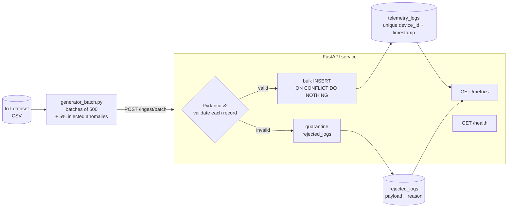

[](https://github.com/tiwari-swapnil-web/telemetry-pipeline/actions/workflows/tests.yml)

# Telemetry Ingestion & Validation Pipeline

A validation-first ingestion microservice for IoT sensor telemetry, inspired by high-throughput
logging pipelines. It accepts JSON readings over HTTP, **validates every record against a strict
schema, quarantines the bad ones (with the reason), bulk-inserts the good ones idempotently**, and
reports pipeline health through a `/metrics` endpoint.

Built and tested against a real dataset: **405,184 environmental sensor readings** from 3 devices
(CO, LPG, smoke, humidity, temperature, light, motion).

## Features

- **Strict validation (Pydantic v2):** MAC-address device IDs, numeric ranges, strict types; unknown or missing fields are rejected.
- **Per-record handling in batches:** one bad record never rejects the rest of the batch.
- **Quarantine table:** every rejected record is stored with its raw payload and the validation message, so nothing disappears silently.
- **Idempotent loads:** a unique `(device_id, timestamp)` key means re-sending data never creates duplicates.
- **Bulk inserts:** one transaction per request; batched `INSERT ... ON CONFLICT DO NOTHING ... RETURNING`, so the inserted-row count is exact.
- **Observability:** `/metrics` reports totals, error rate, rolling throughput and sensor averages; `/health` for liveness.
- **SQLite or PostgreSQL:** chosen by one environment variable (`DATABASE_URL`). Both were run end to end with the current version, including the idempotent re-load.
- **Automated tests:** pytest suite running against a throwaway database.

## Architecture



## Tech stack

Python 3.10+ (developed on 3.14), FastAPI, Uvicorn, Pydantic 2.x, SQLAlchemy 2.x, SQLite / PostgreSQL (Supabase), pandas, requests, pytest.

## Quick start

**Windows (PowerShell)**
```powershell
py -m venv .venv
.venv\Scripts\Activate.ps1      # if blocked: Set-ExecutionPolicy -Scope Process Bypass
pip install -r requirements.txt
copy .env.example .env          # optional: defaults to local SQLite
```

**macOS / Linux**
```bash
python3 -m venv .venv && source .venv/bin/activate
pip install -r requirements.txt
cp .env.example .env            # optional: defaults to local SQLite
```

**Then, on any OS**

1. Download the "Environmental Sensor Telemetry Data" CSV from [Kaggle](https://www.kaggle.com/datasets/garystafford/environmental-sensor-data-132k) and save it as `data/iot_telemetry_data.csv` (git-ignored: 60 MB).
2. Start the API: `uvicorn src.main:app --reload`
3. In a second terminal (activate the venv there too), stream data into it:
   ```
   python -m src.generator_batch              # 20,000 rows (use `py` on Windows)
   python -m src.generator_batch --rows 0     # the full dataset
   ```

Interactive API docs: <http://127.0.0.1:8000/docs>

Generator options: `--rows N` (0 = all), `--batch-size N`, `--anomaly-rate 0.05`, `--seed N` (repeatable runs).

### Run with Docker

```bash
docker compose up --build        # API + PostgreSQL on http://127.0.0.1:8000
```

The compose file starts its own PostgreSQL 16 (demo credentials, local use only) and the API on port 8000. Stream data into it with `python -m src.generator_batch` (use `py` on Windows). To check the rows are in the database:

```bash
docker compose exec db psql -U telemetry -d telemetry -c "select count(*) from telemetry_logs;"
```


## API reference

| Method | Path | Purpose |
|---|---|---|
| POST | `/ingest/batch` | Validate and bulk-insert up to 5,000 records |
| POST | `/ingest` | Validate and insert one record (409 if it already exists) |
| GET | `/metrics` | Totals, error rate, throughput, sensor averages |
| GET | `/logs/recent?limit=10` | Most recent stored readings |
| GET | `/health` | Liveness check |

### Try it (PowerShell)

```powershell
$body = '{"timestamp":1594512094.38,"device_id":"b8:27:eb:bf:9d:51","co":0.0049,"humidity":51.0,"light":false,"lpg":0.0076,"motion":false,"smoke":0.0204,"temp":22.7}'
Invoke-RestMethod -Method Post -Uri http://127.0.0.1:8000/ingest -ContentType "application/json" -Body $body
Invoke-RestMethod http://127.0.0.1:8000/metrics | ConvertTo-Json -Depth 5
```

### Try it (curl)

```bash
curl -X POST http://127.0.0.1:8000/ingest/batch -H "Content-Type: application/json" -d '{
  "records": [
    {"timestamp":1594512094.38,"device_id":"b8:27:eb:bf:9d:51","co":0.0049,"humidity":51.0,"light":false,"lpg":0.0076,"motion":false,"smoke":0.0204,"temp":22.7},
    {"timestamp":1594512095.00,"device_id":"b8:27:eb:bf:9d:51","co":0.0049,"humidity":150.0,"light":false,"lpg":0.0076,"motion":false,"smoke":0.0204,"temp":22.7}
  ]}'
# -> {"received":2,"accepted":1,"duplicates":0,"rejected":1,"sample_errors":[{"index":1,"error":"humidity: Input should be less than or equal to 100"}]}
```

### Sample `/metrics` response (right after loading the full dataset)

```json
{
  "totals": { "received": 405172, "stored": 385104, "rejected": 20068 },
  "error_rate_pct": 4.95,
  "throughput": { "window_seconds": 60, "records_in_window": 405172, "records_per_sec": 6752.87 },
  "unique_devices": 3,
  "averages": { "temperature_celsius": 22.45, "humidity_pct": 60.51, "carbon_monoxide": 0.0046, "smoke": 0.0193 }
}
```

`received` = stored + rejected. Duplicates skipped by the unique key are reported in the `/ingest/batch` response but are not counted as received. `records_per_sec` is the number of records in the last 60 seconds divided by 60, so it is a window average: it understates the peak rate of a load shorter than the window (this load took 41 s) and reads 0 once traffic stops.

## Validation rules

| Field | Rule |
|---|---|
| `timestamp` | number (epoch seconds) |
| `device_id` | MAC address `aa:bb:cc:dd:ee:ff`; trimmed and lower-cased first |
| `co`, `lpg`, `smoke` | number, >= 0 |
| `humidity` | number, 0-100 |
| `temp` | number, -50 to 150 (Celsius) |
| `light`, `motion` | boolean |
| anything else | all fields required; no `null`s |

## Results on the real dataset

Full load of all 405,184 rows (about 5% of records deliberately corrupted by the generator):

| Outcome | Rows |
|---|---|
| Stored | 385,104 |
| Rejected and quarantined | 20,068 (4.95%) |
| Duplicates skipped | 12 |
| **Total** | **405,184** |

Re-running the same 20,000-row load against Supabase Postgres (42.7 s) reported 908 accepted, 18,093 duplicates and 999 rejected, with no double-counted rows.

Quarantined records are stored with their raw payload and the validation message, grouped here by reason:

| Reason | Count |
|---|---|
| `humidity`: above 100 | 6,746 |
| `temp`: not a valid number | 6,738 |
| `device_id`: field required | 6,584 |
| **Total** | **20,068** |

**Data-quality finding:** the source CSV itself contains 13 exact duplicate `(device, timestamp)` rows (the same transmission recorded twice). The unique key makes sure each reading is stored once.

### Throughput

Each row is a different version of the code, so only compare numbers within a version.

- **v1:** single-record `POST /ingest`, one commit per row.
- **v2:** batch endpoint, valid rows bulk-inserted.
- **v3:** v2 + quarantine table + `/metrics` error rate.
- **v4:** v3 + unique `(device_id, timestamp)` key and `ON CONFLICT DO NOTHING`, inserting each chunk as one multi-row `VALUES` statement.
- **v5 (current):** v4, but inserting each chunk with an executemany-style statement plus `RETURNING` (SQLAlchemy batches the rows internally).

| Version | Database | Rows | Time | Throughput |
|---|---|---|---|---|
| v1 | Supabase (remote) | 500 | n/a | ~1 row/s |
| v2 | Supabase (remote) | 20,000 | 47.0 s | 425 rows/s |
| v2 | SQLite (local) | 20,000 | 1.4 s | 14,089 rows/s |
| v3 | SQLite (local) | 20,000 | 1.2 s | 16,445 rows/s |
| v4 | SQLite (local) | 20,000 | 5.3-7.4 s | 2.7-3.8k rows/s |
| v4 | SQLite (local) | 405,184 | 111.8 s | 3,625 rows/s |
| v5 (current) | SQLite (local) | 20,000 | 1.4 s | 14,204 rows/s |
| **v5 (current)** | **SQLite (local)** | **405,184** | **41.3 s** | **9,811 rows/s** |
| **v5 (current)** | **Supabase (remote)** | **20,000** | **42.7-44.5 s** | **450-468 rows/s** |
| **v5 (current)** | **PostgreSQL 16 in Docker (local)** | **20,000** | **2.9 s** | **6,780 rows/s** |

Takeaways:
- Batching improved remote throughput by roughly 400x over single-row inserts. The remote-vs-local gap is network latency, not validation cost.
- Adding idempotency (v4) dropped throughput roughly 4-6x. Running the old and new code side by side in the same folder reproduced the slowdown on the 20k load, so it came from how the insert statement was built, not from the environment. Switching to batched inserts with RETURNING (v5) restored the speed with the unique key still in place (about 3.8x faster on the 20k load). The full-load figures (v4: 3,625 rows/s, v5: 9,811 rows/s) were measured in different folders, so treat that comparison as indicative.
- Throughput on the full dataset (9.8k rows/s) is lower than on the 20k load (14.2k rows/s), which fits a larger table and indexes; the exact cause was not isolated.
- Measured on a single developer laptop; treat the numbers as relative, and expect run-to-run variation.
- On remote Postgres, v5 runs at about the same speed as v2 (~450 rows/s), so the insert-method fix does not help there: network latency dominates.
- Against a local PostgreSQL in Docker, v5 ran at about 6.8k rows/s, versus about 450 rows/s against remote Supabase. That is consistent with network latency dominating the remote result, but the two were measured on different machines, so treat the comparison as indicative.

## Design decisions

- **Plain `def` endpoints:** SQLite and psycopg2 are blocking drivers, so FastAPI runs the handlers in its threadpool instead of blocking the event loop.
- **Validate records individually:** the batch body is `list[dict]` validated record by record, so the response can report exactly which records failed and why.
- **Invalid records never reach the telemetry table:** bad data is stopped at the schema, and the unique key is a second line of defence.
- **Errors do not leak internals:** database failures return a generic 500 and are logged server-side.
- **Same code, two databases:** the dialect-specific `ON CONFLICT` insert is chosen at runtime.

## Tests

```bash
pytest -v
```

The suite uses a temporary SQLite database (never your real data) and covers: valid and invalid single records, duplicates (409), quarantine behaviour, MAC normalisation, mixed batches, idempotent re-loads, duplicates inside one batch, envelope validation, empty and populated `/metrics`, and `/logs/recent` ordering and limits.

CI runs the suite on SQLite (Python 3.10, 3.12, 3.14) and on a PostgreSQL 16 service container.

## Project structure

```
telemetry-pipeline/
├── .github/
│   └── workflows/
│       └── tests.yml        # CI: SQLite (3.10/3.12/3.14) + PostgreSQL service
├── src/
│   ├── __init__.py
│   ├── main.py              # FastAPI app and endpoints
│   ├── schemas.py           # Pydantic models and validation rules
│   ├── database.py          # SQLAlchemy engine, models, dialect helper
│   └── generator_batch.py   # CSV -> anomaly injection -> batched POSTs
├── tests/
│   ├── __init__.py
│   ├── conftest.py          # throwaway test database + client fixture
│   ├── test_api.py
│   └── test_database_url.py # PostgreSQL driver selection
├── data/                    # put iot_telemetry_data.csv here (git-ignored)
├── Dockerfile
├── docker-compose.yml       # API + PostgreSQL for local use
├── .dockerignore
├── .env.example
├── .gitignore
├── pytest.ini
├── requirements.txt
├── README.md
└── LICENSE
```

## Limitations and next steps

- No authentication or rate limiting on the endpoints.
- Metrics are computed with queries on each request; a production system would export counters (e.g. Prometheus).
- Schema changes need a migration tool (Alembic); tables are created with `create_all`.

## Credit
Dataset: [Environmental Sensor Telemetry Data by Gary Stafford (Kaggle)](https://www.kaggle.com/datasets/garystafford/environmental-sensor-data-132k) (CC0: Public Domain)

## License

MIT
